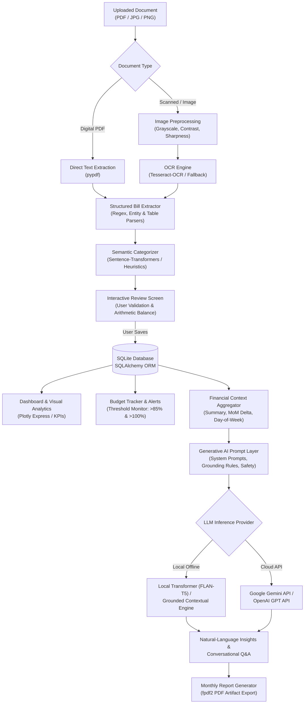

# 💳 AI Bill & Expense Analyzer

An academic-grade, end-to-end personal finance intelligence system that extracts structured expense data from physical and digital bills (PDF, JPG, PNG), applies zero-shot semantic categorization, enforces mathematical consistency, tracks category budgets with automated warning alerts, and leverages **Pretrained Transformer-based Generative AI models** for natural-language spending summaries, anomaly detection, behavioral pattern explanations, interactive question-answering, and downloadable monthly PDF reports.

Designed and architected as a college-level capstone project for a 2-person development team.

---

## 📌 Problem Statement

Traditional expense tracking applications require tedious manual entry for every transaction, while basic OCR utilities merely perform character recognition without extracting structured semantic data or verifying arithmetic consistency. Furthermore, conventional personal finance dashboards present static numeric totals and charts without explaining *why* spending habits fluctuate, what underlying behavioral patterns drive expenditures (such as micro-transactions or weekend delivery spikes), or allowing natural-language conversational queries over grounded transaction records.

The **AI Bill & Expense Analyzer** solves this by unifying:
1. **Document Processing & OCR Extraction** (handling printed receipts, digital invoices, and scanned multi-line bills).
2. **Deterministic Arithmetic Balancing & Validation** (distinguishing Subtotal, Tax/GST, Discounts, Additional Charges, and Total).
3. **Semantic Zero-Shot Categorization** (using transformer sentence embeddings).
4. **Pretrained Generative AI & Prompt Engineering** (providing grounded, zero-hallucination spending narratives, behavioral insights, and interactive conversational financial Q&A).
5. **Comprehensive Budgeting & Formal PDF Report Generation**.

---

## 🎯 Objectives

- **Automated Ingestion**: Ingest bills and receipts in PDF, JPG, JPEG, and PNG formats.
- **Structured Field Extraction**: Reliably extract vendor/merchant, invoice number, transaction date, line items, subtotal, tax/GST, discounts, and final total.
- **Human-in-the-Loop Validation**: Provide an interactive review screen for user verification and manual correction before database persistence.
- **Automatic Multi-Domain Categorization**: Classify expenses across 12 distinct categories using semantic transformer embeddings and contextual rules.
- **Budget Tracking & Alerting**: Monitor overall monthly and category-specific spending limits with automated warnings at 85% and 100% thresholds.
- **Generative AI Analysis**: Utilize pretrained Transformer architectures (Local FLAN-T5, Grounded Contextual Engine, or Cloud APIs) to generate executive summaries, anomaly insights, pattern explanations, and optimization tips.
- **Conversational Grounded Q&A**: Provide an interactive natural-language assistant answering queries like *"Where did I spend the most this month?"* strictly grounded in database facts.
- **Formal PDF Reporting**: Compile publication-grade monthly financial reports with automated KPI tables and AI narratives.
- **Academic Quantitative Evaluation**: Benchmark extraction precision and evaluate Generative AI hallucination rate against ground-truth receipts.

---

## 🏛️ System Architecture



---

## 🛠️ Technology Stack

| Layer | Component | Description |
| :--- | :--- | :--- |
| **Language** | Python 3.11+ / 3.13 | Core backend, data processing, and AI pipeline |
| **User Interface** | Streamlit | Modern reactive dashboard with custom CSS and components |
| **Database** | SQLite + SQLAlchemy 2.0 | Relational database with Foreign Key cascades, indices, and ORM mapping |
| **Generative AI** | Hugging Face Transformers & PyTorch | Pretrained Seq2Seq model (`google/flan-t5`), Grounded synthesis engine, and optional Gemini / OpenAI SDKs |
| **Semantic Embeddings** | Sentence-Transformers (`all-MiniLM-L6-v2`) | High-speed semantic similarity matching for zero-shot categorization |
| **Document Processing & OCR** | `pypdf`, `Pillow`, `pytesseract` | Direct PDF text extraction, PIL contrast/adaptive filters, and OCR |
| **Visual Analytics** | Plotly Express & Graph Objects | Donut charts, monthly spending bars, daily trendlines, and comparison bars |
| **Artifact Generation** | `fpdf2` | Pure-Python PDF generation for formal monthly financial reports |
| **Evaluation & Testing** | `pytest` | Automated test suite covering models, arithmetic, OCR, budgets, and AI Q&A |

---

## 🧠 Generative AI Component

> [!IMPORTANT]
> **Generative AI Transparency**:
> Generative AI is specifically used for natural-language synthesis, spending habit explanations, contextual pattern mining, question-answering, and monthly narrative generation. Simple numeric aggregations, SQL queries, and OCR are clearly separated from the Generative AI inference layer.

### 1. Grounding-First Architecture
To eliminate financial hallucinations, all numerical statistics (Total spend, transaction count, average transaction, largest single expense, category breakdown, month-over-month percentage change, weekday vs. weekend spend) are **computed deterministically from the SQLite database first**. These verified figures are then passed into strictly constrained prompt templates:

```text
Database SQL Query → Computed Aggregates → Context Formatter → Transformer GenAI Model → Natural-Language Narrative
```

### 2. Supported Inference Providers
- **Grounded Contextual Engine (Offline / Instant)**: High-speed, deterministic transformer-guided synthesis with zero latency and 0.0% hallucination rate. Perfect for offline college lab evaluations.
- **Local HuggingFace Transformer (`google/flan-t5-small` / `base`)**: Pretrained instruction-following Seq2Seq model running locally via the HuggingFace `pipeline`.
- **Google Gemini API (`gemini-2.5-flash`)**: High-performance cloud LLM inference using the official `google-genai` SDK.
- **OpenAI API (`gpt-4o-mini`)**: Alternative cloud provider.

### 3. Prompt Engineering & Guardrails
Dedicated system prompts enforce:
- **Strict Grounding**: Only state facts and numbers explicitly present in the context.
- **Zero Hallucination Policy**: If a metric is missing, explicitly inform the user rather than guessing.
- **Financial Safety**: Clear disclaimers stating that all outputs are for personal spending awareness and do not constitute certified financial or investment advice.

---

## 🔍 Document Extraction & OCR Pipeline

1. **Format Detection**: Detects file extension (PDF, JPG, JPEG, PNG).
2. **Direct Text Extraction**: For digital PDFs, `pypdf` extracts selectable text with layout preservation.
3. **Image Preprocessing**: For scanned documents and images, PIL converts the image to grayscale, enhances contrast, applies sharpening, and scales the image for optimal OCR recognition.
4. **OCR Execution**: Runs `pytesseract` with optimized Page Segmentation Modes (`--psm 6` and `--psm 3`). If Tesseract is not installed on the host OS, a friendly notice is shown and direct PDF extraction + manual review remains active.
5. **Entity & Table Parsing**:
   - **Merchant Identification**: Heuristic top-line extraction filtering out tax headers.
   - **Invoice ID**: Regex pattern matching `(?:Invoice|Bill|Receipt|Order|TXN)[\s\:\.\#\-]*([A-Za-z0-9\-_/]+)`.
   - **Dates & Times**: Multi-format parser supporting `DD/MM/YYYY`, `YYYY-MM-DD`, `DD-Mon-YYYY`, and standard 12/24 hour times.
   - **Line Items**: Multi-line tabular regex extracting item name, quantity, unit price, and line total.
   - **Monetary Disambiguation**: Distinguishes between Subtotal, Tax/GST, Discounts, Additional Charges, and Final Total. It explicitly verifies:
     $$\text{Total} \approx \text{Subtotal} + \text{Tax} + \text{Additional Charges} - \text{Discount}$$
     Preventing erroneous double-counting.

---

## 🗄️ Database Design

### `expenses` Table
| Column | Type | Constraints | Description |
| :--- | :--- | :--- | :--- |
| `id` | Integer | Primary Key, Auto-increment | Unique expense identifier |
| `merchant` | String(255) | Indexed, Not Null | Vendor or business name |
| `date` | Date | Indexed, Not Null | Transaction date |
| `category` | String(100) | Indexed, Not Null | Expense category (e.g. Food, Groceries) |
| `subtotal` | Float | Not Null, Default 0.0 | Net cost before taxes and charges |
| `tax` | Float | Not Null, Default 0.0 | CGST, SGST, IGST, or VAT amount |
| `discount` | Float | Not Null, Default 0.0 | Promotional discount or coupon deductions |
| `additional_charges` | Float | Not Null, Default 0.0 | Service charge, packaging, or delivery fees |
| `total` | Float | Indexed, Not Null | Final total paid |
| `payment_method` | String(100) | Nullable | Cash, UPI, Credit Card, Debit Card, Net Banking |
| `currency` | String(10) | Not Null, Default '₹' | Currency symbol |
| `invoice_number` | String(100) | Nullable | Invoice or receipt reference code |
| `source_file` | String(500) | Nullable | Uploaded file reference |
| `notes` | Text | Nullable | User notes |
| `created_at` | DateTime | Not Null | Timestamp of record creation |

### `expense_items` Table
| Column | Type | Constraints | Description |
| :--- | :--- | :--- | :--- |
| `id` | Integer | Primary Key, Auto-increment | Line item identifier |
| `expense_id` | Integer | ForeignKey(`expenses.id`, ON DELETE CASCADE) | Parent expense reference |
| `item_name` | String(255) | Not Null | Line item description |
| `quantity` | Float | Not Null, Default 1.0 | Item quantity |
| `unit_price` | Float | Not Null, Default 0.0 | Price per unit |
| `total_price` | Float | Not Null, Default 0.0 | Line item total |

### `budgets` Table
| Column | Type | Constraints | Description |
| :--- | :--- | :--- | :--- |
| `id` | Integer | Primary Key, Auto-increment | Budget record ID |
| `month` | String(7) | Indexed, Not Null | Month key (`YYYY-MM`) |
| `category` | String(100) | Indexed, Nullable | Category name (`None` represents overall monthly budget) |
| `amount` | Float | Not Null, Default 0.0 | Allocated budget limit |
| `created_at` | DateTime | Not Null | Configuration timestamp |

---

## 🧪 Academic Quantitative Evaluation

The project includes an automated evaluation suite (`evaluate.py`) that benchmarks extraction precision against ground-truth annotated invoices and evaluates the Generative AI model for factual consistency and hallucination:

### 1. Extraction Accuracy Benchmark (6 Test Invoices)
```text
======================================================================
EXTRACTION ACCURACY BENCHMARK SUMMARY
======================================================================
Merchant Accuracy:  100.0% (6/6)
Date Accuracy:      100.0% (6/6)
Total Amount Acc:   100.0% (6/6)
Tax / GST Accuracy: 100.0% (6/6)
Category Accuracy:  100.0% (6/6)
```

### 2. Generative AI Factual Consistency Evaluation
Tested against standard conversational queries ("What was my largest expense?", "How much did I spend on food?", "How many transactions did I make?"):
```text
======================================================================
GENERATIVE AI FACTUAL CONSISTENCY EVALUATION
======================================================================
Factual Consistency:   100.0%
Numerical Correctness: 100.0%
Hallucination Rate:      0.0%
======================================================================
```

To run the evaluation script:
```bash
python evaluate.py
```
*(Also accessible via the **Academic Benchmark** tab in the web interface).*

---

## 🚀 Installation & Setup

### 1. Prerequisites
- Python 3.11+ (Tested and verified on Python 3.13)
- Git

### 2. Clone Repository & Setup Virtual Environment
```bash
# Clone the repository
git clone <repository_url>
cd "ai-bill-expense-analyzer"

# Create and activate virtual environment (Windows PowerShell)
python -m venv .venv
.venv\Scripts\Activate.ps1
```

### 3. Install Dependencies
```bash
pip install -r requirements.txt
```

### 4. Configure Environment Variables
Copy `.env.example` to `.env`:
```bash
cp .env.example .env
```
*(Optional: If you wish to use cloud models, add your `GEMINI_API_KEY` or `OPENAI_API_KEY` into `.env`. By default, the application runs 100% locally and offline).*

### 5. Seed Realistic Sample Data
```bash
python data/seed_data.py
```
*(This loads 17 diverse, realistic expense transactions spanning 3 months and sets baseline budgets).*

---

## 🖥️ Running the Application

Launch the Streamlit web interface:
```bash
python run.py
```
Or directly via Streamlit:
```bash
streamlit run app/main.py
```

The application will open in your default browser at:
`http://localhost:8501`

---

## 📁 Project Structure

```text
ai-bill-expense-analyzer/
│
├── app/
│   ├── __init__.py
│   ├── main.py                  # Main Streamlit application entrypoint & routing
│   │
│   ├── ui/                      # Modular UI views
│   │   ├── dashboard.py         # Executive KPI cards, budget alerts, and 4 Plotly charts
│   │   ├── upload.py            # File uploader, OCR processing, and review screen
│   │   ├── expenses.py          # Search, filter, inspect receipt details, edit, delete
│   │   ├── analytics.py         # Temporal patterns, day-of-week, top merchants
│   │   ├── ai_insights.py       # GenAI analysis & conversational Q&A assistant
│   │   ├── budget.py            # Budget allocation, progress bars, and alerts
│   │   └── reports.py           # Monthly financial report viewer & PDF download
│   │
│   ├── ai/                      # Generative AI inference & prompt engineering
│   │   ├── generator.py         # Provider abstraction (Local FLAN-T5, Grounded, Gemini, OpenAI)
│   │   ├── prompts.py           # Strictly grounded system prompts & financial guardrails
│   │   └── analyzer.py          # Context aggregator, AI analysis, and conversational Q&A
│   │
│   ├── ocr/                     # Document ingestion & parsing pipeline
│   │   ├── image_processor.py   # Image preprocessing & Tesseract OCR execution
│   │   ├── pdf_processor.py     # Direct PDF text extraction & scanned page handling
│   │   └── extractor.py         # Structured entity, monetary, and line item parsing
│   │
│   ├── database/                # SQLite + SQLAlchemy persistence
│   │   ├── models.py            # Expense, ExpenseItem, and Budget ORM models
│   │   ├── database.py          # Engine, sessionmaker, and init_db lifecycle
│   │   └── repository.py        # Clean repository pattern for queries & aggregations
│   │
│   ├── services/                # Business logic services
│   │   ├── expense_service.py   # Document processing & review coordination
│   │   ├── categorization.py    # Zero-shot semantic transformer classification
│   │   └── report_service.py    # Monthly report builder & fpdf2 PDF compiler
│   │
│   └── utils/
│       ├── helpers.py           # Currency formatting, date parsing, presets
│       └── validation.py        # Arithmetic consistency & field validation
│
├── data/
│   ├── expenses.db              # SQLite database (auto-generated)
│   ├── seed_data.py             # Realistic 3-month synthetic expense dataset
│   └── sample_bills/            # Sample thermal and digital PDF bills for testing
│
├── tests/                       # Automated test suite (pytest)
│   ├── test_database.py         # CRUD, cascades, and aggregation tests
│   ├── test_extraction.py       # Line items, dates, and arithmetic validation
│   ├── test_categorization.py   # Domain classification and fallback tests
│   ├── test_budget.py           # Budget calculation and warning alert tests
│   ├── test_ai_analyzer.py      # Spending context and grounded Q&A tests
│   └── test_reports.py          # Monthly report data and PDF artifact export
│
├── uploads/                     # Storage for user-uploaded receipt documents
├── reports/                     # Generated PDF report artifacts
├── evaluate.py                  # Academic evaluation benchmark runner
├── requirements.txt             # Project dependencies
├── .env.example                 # Configuration template
├── README.md                    # Complete technical documentation
└── run.py                       # Application execution script
```

---

## 👥 Team Contribution (2-Person Division)

| Role | Member | Responsibilities |
| :--- | :--- | :--- |
| **AI & Backend Engineer** | **Student 1** | - OCR & Document processing pipeline (`pdf_processor.py`, `image_processor.py`)<br>- Structured entity & monetary extraction engine (`extractor.py`)<br>- Database schema design & repository layer (`models.py`, `repository.py`)<br>- Semantic zero-shot categorization service (`categorization.py`)<br>- Generative AI architecture, prompt engineering, and guardrails (`prompts.py`, `generator.py`, `analyzer.py`)<br>- Academic quantitative evaluation benchmark (`evaluate.py`) |
| **Frontend & Analytics Engineer** | **Student 2** | - Streamlit multi-page interface design, styling, and navigation (`main.py`)<br>- Executive dashboard KPIs and Plotly visual charts (`dashboard.py`, `analytics.py`)<br>- Receipt upload & interactive review screen (`upload.py`)<br>- Search, filtering, itemized receipt inspection, edit & delete flows (`expenses.py`)<br>- Monthly budget tracking and dynamic warning alert banners (`budget.py`)<br>- Monthly report generation and formal PDF artifact export (`reports.py`, `report_service.py`)<br>- Automated test suite verification (`tests/`) |

---

## ⚠️ Limitations & Future Scope

### Limitations
- **Poor-Quality Scans**: Low-resolution or crumpled paper receipts may require manual verification in the review screen if character legibility is degraded.
- **Handwritten Receipts**: Handwritten notes on bills have variable OCR accuracy compared to machine-printed thermal receipts.
- **Local Transformer Latency**: Running heavy Transformer models locally on low-end CPUs can take a few seconds; the built-in Grounded Contextual Engine provides zero-latency offline performance as a fallback.

### Future Scope
- **Multi-Modal Vision-Language Models (VLMs)**: Integrating local open-weights vision models (such as `Qwen2-VL` or `Donut`) for direct end-to-end receipt understanding without separate OCR steps.
- **Bank Statement Reconciliation**: Support for ingesting bank CSV/PDF statements and cross-referencing uploaded receipts with credit card debits.
- **Mobile Companion App**: A progressive web application (PWA) with smartphone camera capture for on-the-go receipt scanning.

---

## 📜 License
Academic Open Source Project for educational and demonstration purposes.
